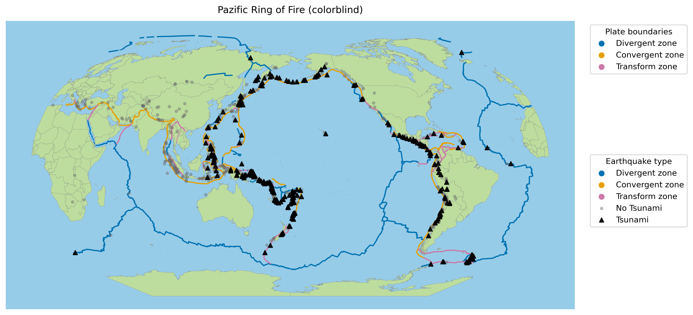
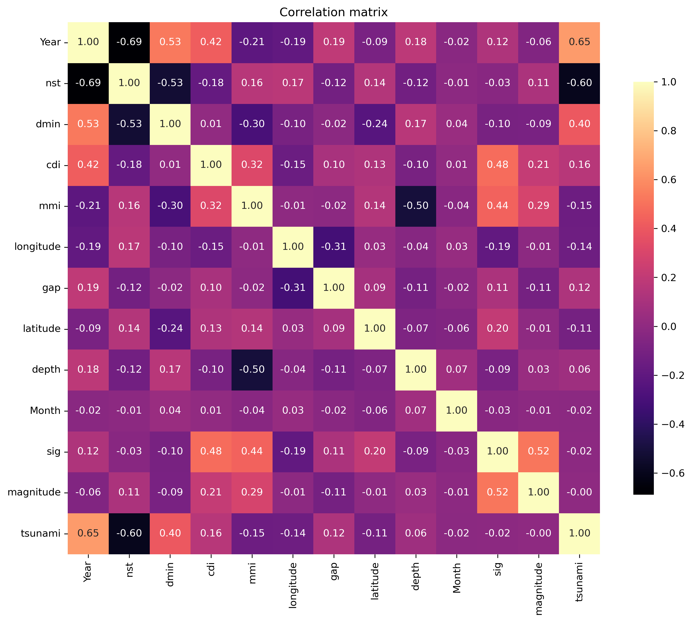
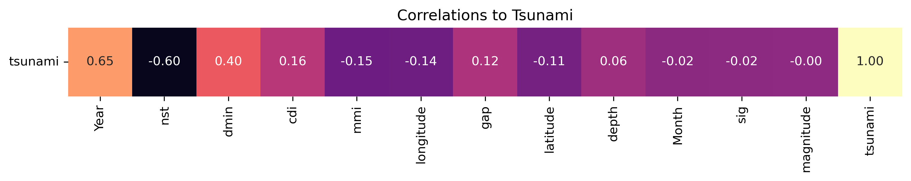
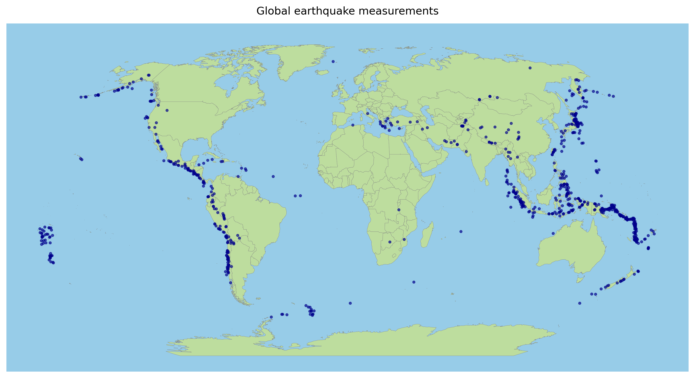
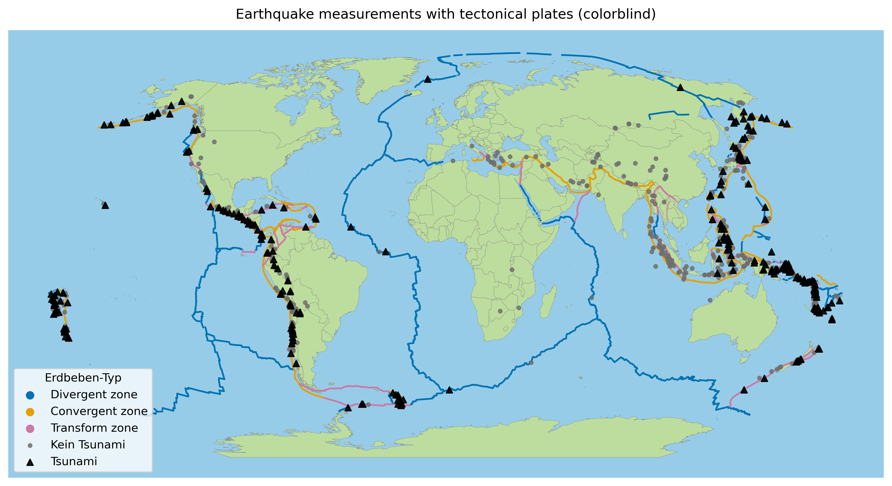
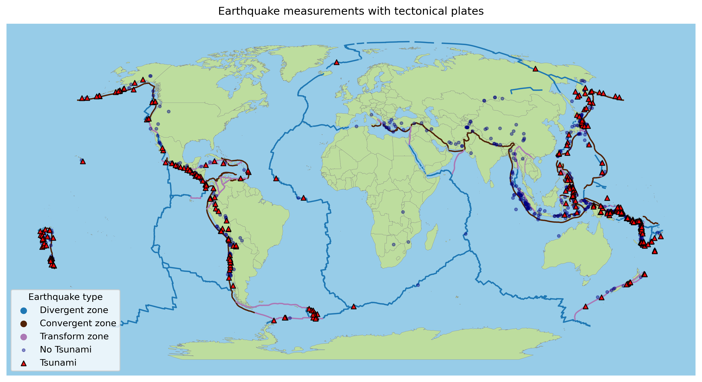

# Global Earthquakes and Tsunami Risk: A Geovisualization

Where do tsunami-generating earthquakes happen, and which measurements hint at them? A visual analysis of 782 large earthquakes (2001-2022) in relation to tectonic plate boundaries, with colour-blind-safe design choices.

<p>
  
  
  
  
  
</p>

<p align="center">
  
</p>

Course project for data visualization (HS25). You can read the full write-up in the [project report (PDF)](gdv_project_report.pdf) and the [presentation (PPTX)](Presentation.pptx). The code that produces every figure is in [`Visualization.ipynb`](Visualization.ipynb).

## Key findings

- **Tsunamis cluster along the Pacific coast.** Most tsunami-generating earthquakes lie offshore, along convergent plate boundaries where one plate is pushed under another (subduction).
- **Magnitude alone does not separate the two groups.** Its correlation with the tsunami label is about 0.00. Where an earthquake happens matters more than how strong it is.
- **The strongest numerical correlations are partly measurement effects.** `Year` (0.65) mostly reflects better monitoring over time, while `nst` (-0.60) and `dmin` (0.40) reflect the offshore location of tsunami events.
- **Design choices matter.** The maps use a colour-blind-safe palette and encode the tsunami label by symbol shape, not by colour.

## Dataset

782 earthquakes from 2001 to 2022 with no missing values. The magnitude ranges from 6.5 to 9.1 (mean 6.94), and 28 events reach magnitude 8 or more, including the 2004 and 2011 mega-earthquakes (9.1). 304 events (38.9 %) triggered a tsunami and 478 (61.1 %) did not.

| Feature | Meaning |
|---|---|
| `magnitude` | Recorded earthquake magnitude |
| `cdi` | Community Decimal Intensity |
| `mmi` | Modified Mercalli intensity (instrumental) |
| `sig` | Event significance level |
| `nst` | Number of seismic stations that recorded the event |
| `dmin` | Distance to the nearest seismic station |
| `gap` | Azimuthal gap between stations (degrees) |
| `depth` | Focal depth (km) |
| `latitude`, `longitude` | Epicentre location |
| `Year`, `Month` | Time of the event |
| `tsunami` | Tsunami occurred (1) or not (0), the target variable |

## 1. Which measurements relate to tsunamis?

The Pearson correlation of every feature with the `tsunami` label was computed first, since most features are continuous. The full matrix gives an overview, and a single row sorted by absolute value makes the relationship with the target easy to read.

<p align="center">
  
</p>

<p align="center">
  
</p>

| Feature | Correlation with `tsunami` | Interpretation |
|---|---|---|
| `Year` | +0.65 | Probably a reporting effect: networks grew and more tsunamis were reliably recorded. Useful statistically, not a physical cause. |
| `nst` | -0.60 | Offshore events are recorded by fewer stations. Reflects both data geometry and real geography. |
| `dmin` | +0.40 | A large distance to the nearest station points to offshore or remote events, where tsunamis typically start. |
| `magnitude` | 0.00 | Does not separate tsunami from non-tsunami events in this dataset. |

Correlation does not imply causation. These numbers only tell us where to look next, which is the map.

## 2. Where do the earthquakes happen?

Because location carries so much signal, the next step is spatial: plot the events on a world map and add the tectonic plate boundaries.

<p align="center">
  
</p>

Adding the plate boundaries and splitting the events by tsunami label (black triangles = tsunami, grey dots = no tsunami):

<p align="center">
  
</p>

Centring the map on the Pacific shows the **Ring of Fire**: tsunami events line the margins of the ocean, mostly along convergent (subduction) boundaries rather than divergent or transform ones.

<p align="center">
  
</p>

## Design rationale

| Decision | Why |
|---|---|
| **Magma colour map** for the correlation matrix | Perceptually uniform and readable with common forms of colour vision deficiency. Keeps contrast when printed in greyscale. |
| **Robinson projection** for the maps | A balanced compromise between distortion of area, shape and distance, well suited to global thematic maps. |
| **Okabe-Ito palette** for plate boundaries | Designed to be colour-blind safe. Blue = divergent, orange = convergent, pink = transform. |
| **Shape and grey/black tones** for the tsunami label | The target variable is encoded by form and contrast instead of colour, so it stays readable for everyone. |

The first version of the plate map used blue, brown and purple. The final version replaces them with the Okabe-Ito colours:

| First version | Colour-blind-safe version |
|---|---|
|  |  |

## Limitations

- The map analysis is visual. It shows where tsunami events cluster but does not fit or test a predictive model.
- The dataset contains only large events (magnitude 6.5 and above), so smaller tsunami-generating earthquakes are not covered.
- `Year`, `nst` and `dmin` partly reflect how events were measured and reported, not only how they happened.

## Repository structure

```
.
├── Visualization.ipynb   # Data preparation, maps and correlation plots
├── gdv_project_report.pdf
├── Presentation.pptx
├── pics/                 # Figures exported by the notebook
├── data/                 # Earthquake CSV, plate boundary shapefiles, country borders
└── references/           # Bibliography and cited sources
```

## Run it yourself

```bash
pip install -r requirements.txt
jupyter notebook Visualization.ipynb
```

Start the notebook from the repository root, because the data paths (`./data/...`) and the output folder (`pics/`) are relative to it.

## Data sources and references

- **Earthquake data:** [Global Earthquake-Tsunami Risk Assessment Dataset](https://www.kaggle.com/datasets/ahmeduzaki/global-earthquake-tsunami-risk-assessment-dataset) (Kaggle).
- **Plate boundaries:** [Tectonic plates](https://data.humdata.org/dataset/tectonic-plate) (Humanitarian Data Exchange), based on the PLATES project of the Institute for Geophysics, University of Texas at Austin.
- **Country borders:** [Natural Earth](https://www.naturalearthdata.com/), 1:50m Admin 0 countries.
- Nunez, J. R., Anderton, C. R., & Renslow, R. S. (2018). Optimizing colormaps with consideration for color vision deficiency to enable accurate interpretation of scientific data. *PLOS ONE*, 13(7), e0199239. [doi:10.1371/journal.pone.0199239](https://doi.org/10.1371/journal.pone.0199239)
- [Color palette](https://siegal.bio.nyu.edu/color-palette/), Siegal Lab (Okabe-Ito colours).
- [Robinson Projection: A Balanced World Map Explained](https://thecartographicinstitute.com/robinson-projection-a-balanced-view-of-the-world/), The Cartographic Institute.
- [What is it about an earthquake that causes a tsunami?](https://www.usgs.gov/faqs/what-it-about-earthquake-causes-a-tsunami), U.S. Geological Survey.
- [Plate Tectonics and the Ring of Fire](https://education.nationalgeographic.org/resource/plate-tectonics-ring-fire), National Geographic.

Please check the terms of use of the original datasets before reusing the data.
